# soc-lab-suricata

Project 3 of an 8-project home SOC lab series (October 2026): a dedicated
**Suricata network IDS sensor**, a **custom SSH brute-force signature**, and
**alert forwarding into Wazuh** so network detections and host detections end
up in one dashboard.

**Author:** Ozan Sonmez | [github.com/sonmez-ozan](https://github.com/sonmez-ozan)

**Skills demonstrated:** NIDS deployment and capture-interface design,
Suricata rule writing and thresholding, rule-management hygiene
(`suricata-update` vs. local rules), SIEM log ingestion (JSON/`eve.json`),
detection validation with a live attack, and systematic troubleshooting.

| Detection | MITRE ATT&CK | Status |
|---|---|---|
| SSH brute-force (connection-volume threshold), `sid:1000001` | T1110 Brute Force | Built, validated, ingested by Wazuh |
| Port scan (Nmap SYN scan) | T1046 Network Service Discovery | **Not detected** by stock rules in this lab. Open gap, see Next steps |

*ATT&CK mapping is my own classification; the Suricata rule itself carries no MITRE metadata.*

Builds on:
- [soc-lab-infrastructure](https://github.com/sonmez-ozan/soc-lab-infrastructure): pfSense, VLANs, WireGuard, core VMs
- [soc-lab-wazuh](https://github.com/sonmez-ozan/soc-lab-wazuh): Wazuh SIEM, custom FIM, host-based brute-force detection, Active Response

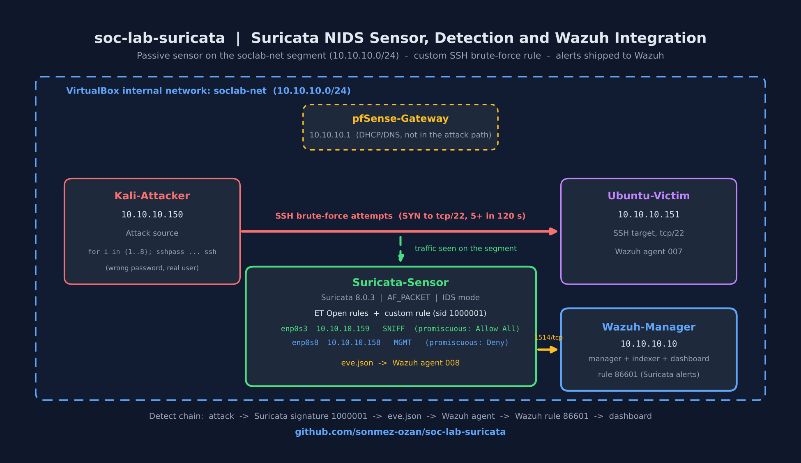

## The core story: observe, test the defaults, add a detection, ship the alert

1. **Observe** - A passive sensor VM sits on the `soclab-net` segment with a
   promiscuous sniffing interface and sees traffic between Kali and the victims.
2. **Test the defaults** - With 53k stock Emerging Threats Open rules loaded, a
   Nmap SYN scan from Kali against Ubuntu-Victim produced **no alert**. The
   only alert in the log came from background DHCP traffic.
3. **Add a detection** - A custom rule (`sid:1000001`) alerts when one source
   sends 5 or more TCP SYNs to port 22 within 120 seconds. This covers SSH
   brute-force-style connection bursts, mirroring the thresholds of the
   Project 2 Wazuh rule. It does **not** detect the port scan from step 2; that
   gap is still open.
4. **Validate** - 8 SSH attempts from Kali with a wrong password triggered the
   alert, with the right source and destination in `eve.json`.
5. **Integrate** - A Wazuh agent on the sensor reads `eve.json`. The same alert
   appears in the Wazuh dashboard (rule `86601`) with `src_ip`, `dest_ip` and
   the signature as searchable fields.

Same layering idea as Project 2: a network-side and a host-side detection for
the same behavior (SSH brute force), both feeding one SIEM.

**Not tested:** whether the stock ruleset would have caught the SSH burst on its
own. The custom rule was added before that comparison was run, so this README
does not claim the stock rules miss it.

## Environment

| Component | Detail |
|---|---|
| Sensor VM | `Suricata-Sensor`, Ubuntu Server 26.04 LTS |
| Suricata | 8.0.3 RELEASE, AF_PACKET capture, IDS mode |
| Sniffing interface | `enp0s3`, `10.10.10.159`, VirtualBox promiscuous mode **Allow All** |
| Management interface | `enp0s8`, `10.10.10.158`, promiscuous mode **Deny** |
| Network | VirtualBox internal network `soclab-net`, `10.10.10.0/24` (pfSense `10.10.10.1`) |
| Attacker | Kali-Attacker, `10.10.10.150` |
| Target | Ubuntu-Victim, `10.10.10.151` (hostname `ozzy`, Wazuh agent 007) |
| SIEM | Wazuh 4.14.7, manager/indexer/dashboard at `10.10.10.10` |
| Sensor agent | Wazuh agent 008 (`suricata-sensor`), registered under `10.10.10.158` |
| Rules | ET Open via `suricata-update` (69,072 total, 53,117 enabled) + `local.rules` |

Kali and Ubuntu-Victim are dual-homed (native Management-LAN address plus a
tagged VLAN sub-interface). This project uses the Management-LAN addresses,
same as the Wazuh project. See [`02-network-design.md`](https://github.com/sonmez-ozan/soc-lab-infrastructure/blob/main/docs/02-network-design.md).

## Build

### 1. Sensor VM and interfaces

A dedicated sensor VM was chosen over a pfSense package to mirror how a real
sensor sits on a segment as its own host. The VM has two adapters on
`soclab-net`:

| Adapter | Guest NIC | IP | Promiscuous mode | Role |
|---|---|---|---|---|
| 1 | `enp0s3` | 10.10.10.159 | Allow All | Sniffing |
| 2 | `enp0s8` | 10.10.10.158 | Deny | Management (SSH, Wazuh agent) |

Splitting the roles keeps management traffic out of the capture interface.

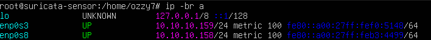
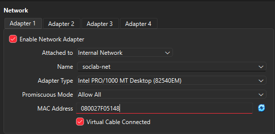
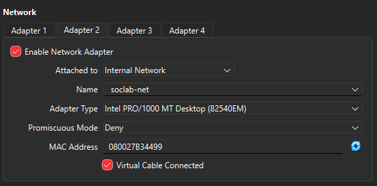

### 2. Suricata

Suricata 8.0.3 was installed with AF_PACKET support, the capture interface
was changed from `eth0` to `enp0s3`, and the ET Open ruleset was loaded:

```bash
sudo sed -i '0,/interface: eth0/s//interface: enp0s3/' /etc/suricata/suricata.yaml
sudo suricata-update
sudo suricata -T -c /etc/suricata/suricata.yaml -v
sudo systemctl enable --now suricata
```

`$HOME_NET` defaults to `[192.168.0.0/16,10.0.0.0/8,172.16.0.0/12]`, which
already contains `10.10.10.0/24`. This was checked on purpose: a custom rule
bound to `$HOME_NET` would never match if the lab range were outside it.

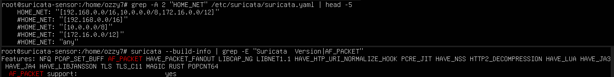

### 3. Testing the defaults: the Nmap scan goes undetected

Nmap scans from Kali (`-sS -T4`, and earlier `-sV -T4 -p-` against the sensor)
produced no alert from the stock ET Open rules. The only signatures present in
`eve.json` were the custom rule (added later) and a DHCP alert,
`ET INFO Possible Kali Linux hostname in DHCP Request Packet` (sid 2022973),
triggered by Kali's DHCP traffic, not by the scan.

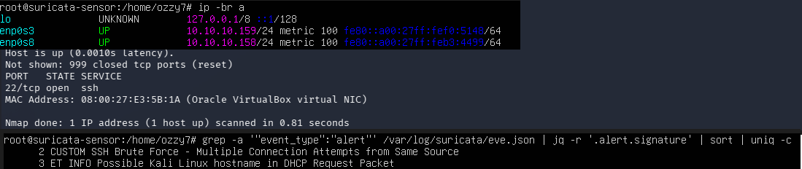

Scope of this finding: a single-source SYN scan of one host went undetected by
the default ruleset *in this lab*. It is not a claim that Suricata or ET Open
cannot detect scans in general. The custom rule below is for SSH connection
bursts and would not fire on this scan, which sends one SYN per port.

### 4. Custom rule

`configs/local.rules`:

```
alert tcp any any -> $HOME_NET 22 (msg:"CUSTOM SSH Brute Force - Multiple Connection Attempts from Same Source"; flow:to_server; flags:S; threshold:type both, track by_src, count 5, seconds 120; classtype:attempted-recon; sid:1000001; rev:1;)
```

| Part | Meaning |
|---|---|
| `alert tcp any any -> $HOME_NET 22` | TCP from anywhere to port 22 on the home network |
| `flow:to_server` | Only client-to-server direction |
| `flags:S` | Only SYN packets, i.e. new connection attempts |
| `threshold:type both, track by_src, count 5, seconds 120` | Alert once when a single source reaches 5 SYNs inside 120 s, then stay quiet for the rest of the window |
| `classtype:attempted-recon` | Classification used in the alert metadata |
| `sid:1000001` | Local SID range (1,000,000+) |

The thresholds mirror the Wazuh rule from Project 2 (5 failures / 120 s / same
source) so the two layers are comparable. **Difference:** Wazuh counts failed
*authentications* from the auth log; this rule counts *connection attempts* on
the wire, so it also fires without any credential being tried (for example a
script opening many SSH connections) and does not know whether a login failed.

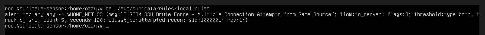

### 5. Registering the rule

`suricata-update` owns `/var/lib/suricata/rules/` (`default-rule-path`), so the
custom file lives in `/etc/suricata/rules/` and is referenced by absolute path.
A rule update can therefore never overwrite it.

```bash
cp /etc/suricata/suricata.yaml /etc/suricata/suricata.yaml.bak
sed -i '2311a\  - /etc/suricata/rules/local.rules' /etc/suricata/suricata.yaml
suricata -T -c /etc/suricata/suricata.yaml -v
systemctl restart suricata
```

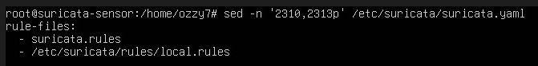

Validation: **2 rule files processed, 53,118 rules loaded, 0 failed** (53,117
ET Open + 1 custom).

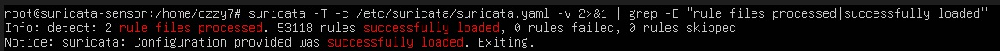
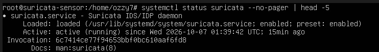

### 6. Attack and detection

From Kali, 8 SSH attempts with a wrong password against a real account
(`scripts/trigger-ssh-bruteforce.sh`):

```bash
for i in {1..8}; do sshpass -p 'wrongpass' ssh -o StrictHostKeyChecking=no ozzy7@10.10.10.151 exit; done
```

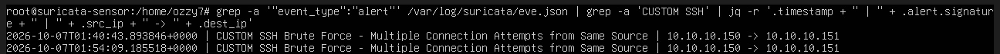

*The screenshot is from the second run (the 01:54 alert below); the first alert came from an identical earlier loop.*

On the sensor, `eve.json` shows the custom alert, with Kali as source and
Ubuntu-Victim as destination:

```bash
grep -a '"event_type":"alert"' /var/log/suricata/eve.json | grep -a 'CUSTOM SSH' \
  | jq -r '.timestamp + " | " + .alert.signature + " | " + .src_ip + " -> " + .dest_ip'
```

```
2026-10-07T01:40:43Z | CUSTOM SSH Brute Force - Multiple Connection Attempts from Same Source | 10.10.10.150 -> 10.10.10.151
2026-10-07T01:54:09Z | CUSTOM SSH Brute Force - Multiple Connection Attempts from Same Source | 10.10.10.150 -> 10.10.10.151
```

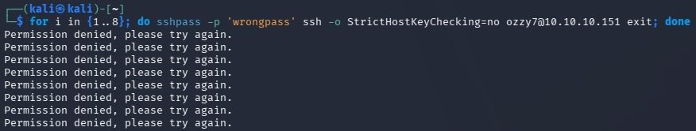

Eight attempts produce **one** alert per window, not eight, because of
`threshold:type both`. The second timestamp comes from a later run, after the
120-second window had reset.

### 7. Wazuh integration

A Wazuh agent was installed on the sensor (agent 008, v4.14.7, registered under
`10.10.10.158`) and pointed at Suricata's JSON log. Wazuh includes decoders and
rules for Suricata, so no custom parsing was needed.

```xml
<localfile>
  <log_format>json</log_format>
  <location>/var/log/suricata/eve.json</location>
</localfile>
```

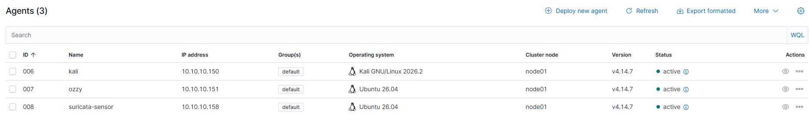
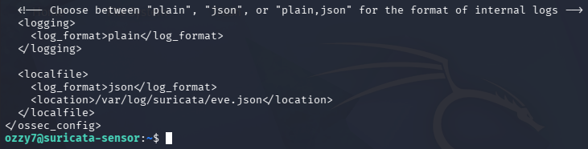

Re-running the attack produced the alert in the dashboard (Threat Hunting >
Events, agent `suricata-sensor`, `rule.id:86601`). The expanded event carries
the fields needed for triage:

| Field | Value |
|---|---|
| `data.alert.signature` | CUSTOM SSH Brute Force - Multiple Connection Attempts from Same Source |
| `data.alert.signature_id` | 1000001 |
| `data.src_ip` | 10.10.10.150 |
| `data.dest_ip` | 10.10.10.151 |
| `data.dest_port` | 22 |
| `agent.name` / `agent.id` | suricata-sensor / 008 |

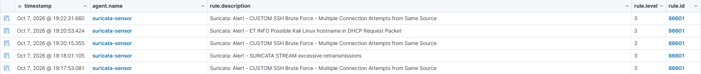
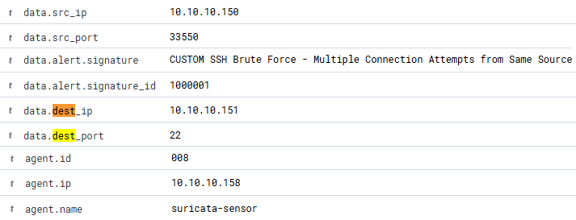

Three CUSTOM SSH alerts (19:17:53, 19:20:15, 19:22:31) appear about two
minutes apart in the dashboard, consistent with the 120-second re-arm.

## Detection chain

```
Kali SSH attempts -> Suricata sid 1000001 -> eve.json -> Wazuh agent 008
                  -> Wazuh rule 86601 -> Wazuh dashboard
```

## Lessons learned and troubleshooting

| Problem | Cause | Fix / takeaway |
|---|---|---|
| Multi-line heredoc paste hung at a `>` prompt | Terminal collapsed the paste into one line, so the closing `EOF` never registered | Create the file with a single-line `echo '...' \| sudo tee` instead. Single quotes keep `$HOME_NET` literal |
| Config validated but the rule did not fire | The restart command was mistyped, so the service was still running the old rules. `systemctl status` showed a start time from before the edit | After a restart, check the "active since" time, not just "active (running)" |
| `grep: binary file matches` on `eve.json` | `eve.json` contains non-text bytes | Use `grep -a` |
| `wget` failed with "Temporary failure in name resolution" | Most likely pfSense's DNS resolver was not yet answering right after boot (root cause not confirmed). `ping 1.1.1.1` worked, and later the name resolved | Test by IP first to separate routing from DNS, then retry. This one cleared on its own |
| Wazuh logged "Log file eve.json is duplicated" | `ossec.conf` has **two** `<ossec_config>` sections, and a `sed` insert before every `</ossec_config>` added the block twice | Find the lines with `grep -n`, delete the second copy, restart the agent. Insert into one specific section next time |
| Dashboard timed out from the Windows host | WireGuard tunnel was not active, so the host had no route to `10.10.10.0/24` | Bring the tunnel up, or use Kali's browser. `curl -kI https://10.10.10.10` from Kali (HTTP 302) proved the dashboard itself was healthy |

### Notes on reading the evidence

- Suricata logs timestamps in **UTC**. The Wazuh dashboard and Kali show local
  time (EDT, UTC-4). The clocks agree; the zones do not.
- The sensor has two interfaces on one subnet, so its routing table shows two
  default routes at the same metric. It works, but it is worth knowing when
  reading flows.
- The Wazuh agent list shows Ubuntu-Victim as `ozzy`, which is the VM's hostname.
- During one run the dashboard also showed `SURICATA STREAM excessive
  retransmissions` (rule 86601, level 3), and the Kali loop hit
  `Connection timed out` on later attempts. Both were observed and not
  investigated further here.

## How I used AI

I used Claude as a pair-programming and documentation partner on this project.

**Where it helped**
- Sensor design options (dedicated VM vs. pfSense package, sniffing vs. management interface)
- Explaining errors and suggesting next commands while I troubleshot
- Drafting the rule explanation, README, architecture diagram and LinkedIn banner, plus a review pass for overclaims

**What I did myself**
- Built the VMs and ran every install, config edit and attack from my own terminals
- Verified each step against live output: `systemctl` status, `suricata -T`, `eve.json` and the Wazuh dashboard
- Captured all screenshots from my own lab, and reviewed the final write-up

## Limitations

- Suricata runs in **IDS mode**. It alerts and does not block.
- The rule is a volume threshold on SYNs, not an authentication check. It would
  also fire on legitimate bursts of SSH connections (for example automation).
- Tuning was limited to one rule and one port. No false-positive testing was done.
- Wazuh raises these as level 3 alerts. Escalation or correlation with the
  Project 2 host rule (`100010`) is not set up.

## Next steps

- Correlate the Suricata alert with the Wazuh host rule `100010` for the same source IP.
- Trigger Wazuh Active Response from the network alert.
- Add a custom port-scan rule (many destination ports from one source) to close the Nmap gap shown above.
- Run the missing comparison: disable `local.rules` and repeat the SSH loop to see whether the stock ruleset alerts on it.
- Try inline IPS mode.

## Repo structure

```
soc-lab-suricata/
├── README.md
├── configs/
│   ├── local.rules
│   ├── suricata.yaml.snippets.yaml
│   └── ossec.conf.suricata-snippet.xml
├── scripts/
│   ├── trigger-ssh-bruteforce.sh
│   └── verify-alert.sh
├── diagrams/
│   └── soc-lab-suricata-architecture.png
└── screenshots/
    ├── 00-stock-rules-gap.png
    ├── 01-sensor-interfaces.png
    ├── 02a-virtualbox-adapter1-sniffing.png
    ├── 02b-virtualbox-adapter2-management.png
    ├── 02c-home-net-and-build-info.png
    ├── 03-custom-rule.png
    ├── 04-rule-files-config.png
    ├── 05-config-validation.png
    ├── 06-attack-from-kali.png
    ├── 07-alert-triggered.png
    ├── 08-service-status.png
    ├── 09-agent-connected.png
    ├── 10-ossec-localfile.png
    ├── 11-suricata-alerts-in-wazuh.png
    └── 12-alert-detail-fields.png
```

## Stack

- **Suricata 8.0.3** (AF_PACKET, ET Open ruleset, `suricata-update`)
- **Wazuh 4.14.7** (manager, indexer, dashboard, agent 008)
- **pfSense** gateway and **VirtualBox** internal network (Project 1)
- **Kali Linux** (Nmap, sshpass) as the attacker
- **Ubuntu Server 26.04** as sensor and victim
